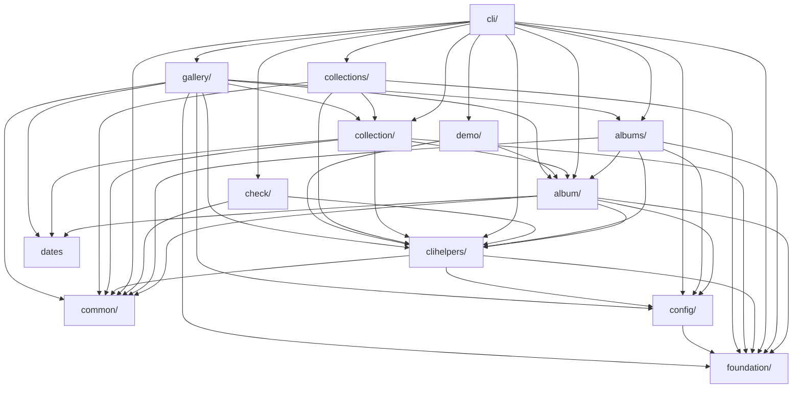

# Architecture

[README.md](../README.md) documents the main use cases and philosophy that guide the design of photree.

For the domain concepts (albums, media sources, collections, naming conventions), see
[domain.md](./domain.md). For the on-disk layout and metadata formats, see
[internals.md](./internals.md).

This document is for contributors navigating the codebase: the module-level
dependency graph, the layering rules behind it, and where each concern lives.

<!-- BEGIN MODULE OVERVIEW (auto-generated by: mise run depgraph — do not edit manually) -->
## Module Overview

Dependencies between top-level modules (auto-generated via `mise run depgraph`):

<!-- END MODULE OVERVIEW -->

### Layering

The top-level packages form layers. A package imports only from layers below
it, and packages on the same line (`|`) do not import each other:

```
cli
gallery | demo | check
albums | collections
collection
album
clihelpers
config
foundation
dates | common
```

These rules are enforced by `mise run boundaries-check` (part of
`mise run check`) through the [import-linter](https://import-linter.readthedocs.io/)
contracts in `pyproject.toml` (`[tool.importlinter]`). The generated graph
above only *shows* dependencies; the contracts are the source of truth and
reject a new import that breaks a rule. See
[guidelines.md — Module boundaries](./guidelines.md#coding) for how to change
them.

- **Domain code never depends on the CLI layer**, directly or indirectly. The
  CLI layer is `cli/`, every `*/cli/` subpackage, `albums/batchcli/`,
  `clihelpers/` and `typer`. Domain output layers render dependency statuses
  with `common/sysdeps_output.py` rather than through `clihelpers/`.
- **Only CLI modules import `clihelpers` or `typer`.** `clihelpers/` sits low
  in the stack only because `album/cli/` uses it; the contracts keep it out of
  the domain modules of every package above it.
- **Command groups share `albums/batchcli/`, not each other.** `gallery/cli/`
  reuses the batch layer through `albums/batchcli/` and never imports
  `albums/cli/`; `albums/batchcli/` never imports `albums/cli/` either.
  Likewise, the `albums` CLI and the entry point reach album-level CLI pieces
  only through `album/cli/import_preflight.py` and
  `album/cli/media_source_conflict.py`.
- **No heavy imports at startup.** The face ML stack is imported only inside
  the functions that use it. import-linter still sees function-level imports,
  so this is not a contract: `tests/unit/test_cli_startup_imports.py` checks
  it at runtime.

### Package Map

Where each concern lives, ordered by the layers above, from the base up:

| Layer | Packages | Contents |
|---|---|---|
| Base | `dates`, `common/` | `dates`: the date grammar shared by album and collection names (specs, inclusive ranges, containment/overlap, timestamp matching). `common/`: filesystem, EXIF and `sips` wrappers, system dependency list, formatting, parallelism |
| Foundation | `foundation/` | The types every other package builds on: `model` (`PhotreeModel` YAML base), `metadata_io` (YAML read/validate/write, `InvalidMetadataError`), `layout` (`.photree`, `albums`, `collections`, `browsable`, share sentinel names), `linking` (`LinkMode`), `share_layout` (export layout enums), `gallery_metadata` (`gallery.yaml` and gallery resolution) |
| Config | `config/` | The user config file: models (`protocol.py`) and loader |
| CLI helpers | `clihelpers/` | CLI-only infrastructure: console, options, progress bars, gallery resolution, the system dependency gate, config error rendering |
| Album | `album/` | Everything about a single album, described below |
| Collection | `collection/` | Everything about a single collection, described below |
| Batch | `albums/`, `collections/` | Operations over a set of albums or collections, no gallery needed |
| Gallery & tools | `gallery/`, `demo/`, `check/` | `gallery/`: gallery-level orchestration. `demo/`: `photree demo`. `check/`: `photree check system` |
| Root app | `cli/` | The top-level Typer app (`app.py`), which mounts every command group |

Each domain package keeps its core logic and its Typer commands (`cli/`) side
by side; output helpers live next to the logic they render (`output.py`).

- **`album/`** — media knowledge is split by concern:
  - `formats.py` (recognized extensions, JPEG/priority rules), `naming.py`
    (album name grammar and the light check), `staging.py`
    (`to-import-*` staging entry names), `id.py` (album and media IDs).
  - `store/` — the `.photree/` layout and `AlbumMetadata` (`protocol.py`),
    the `MediaSource` model and its key functions (`media_source.py`), album
    and media source discovery, media ID metadata.
  - `importer/` (`album import`, Image Capture selection, std staging,
    collision checks, preflight), `exporter/` (export to a share directory),
    `refresh.py` with `browsable.py`, `jpeg.py`, `exif_cache/` and `faces/`
    (derived data), `media.py` (move/remove media across sources).
  - `check/` (the full check, including `exif_date_check.py` for EXIF date
    matching), `fix/` (repairs, with iOS-specific fixes in `fix/ios/`),
    `stats/`.
- **`collection/`** — `naming.py`, `store/` (metadata and discovery),
  `init.py`, `importer/` (`collection import`), `check.py`, `stats/`, and
  `refresh/`: membership refresh with one module per phase (`scan`,
  `title_sync`, `implicit` / `implicit_match` / `series`, `smart`),
  orchestrated by `refresh_collections`. See
  [internals.md — Collection Refresh](./internals.md#collection-refresh).
- **`albums/`** — `cmd_handler/` holds the pure batch logic; `batchcli/` the
  batch presentation layer shared by the `albums` and `gallery` command groups
  (one `run_batch_*` wrapper per operation, plus `resolution` for
  `--dir` / `--album-dir` to an album list); `cli/` only the `albums` commands
  themselves. `index.py` and `media_index.py` map IDs to paths and detect
  duplicates; `renamer.py` plans batch renames from CSV.
- **`gallery/`** — gallery-level orchestration only: `import_plan.py`,
  `importer.py` and `cmd_handler/` (`gallery import`), `browsable_refresh.py`
  (the `browsable/` tree), `faces/` (clustering), `index.py`, `stats.py`.
  `gallery refresh` delegates collection membership to
  `collection.refresh_collections`.
